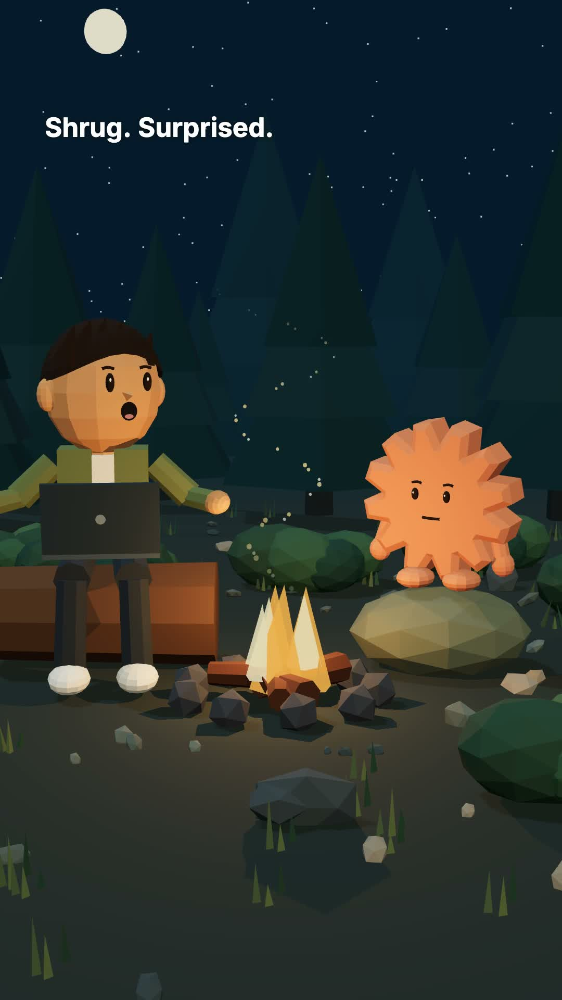
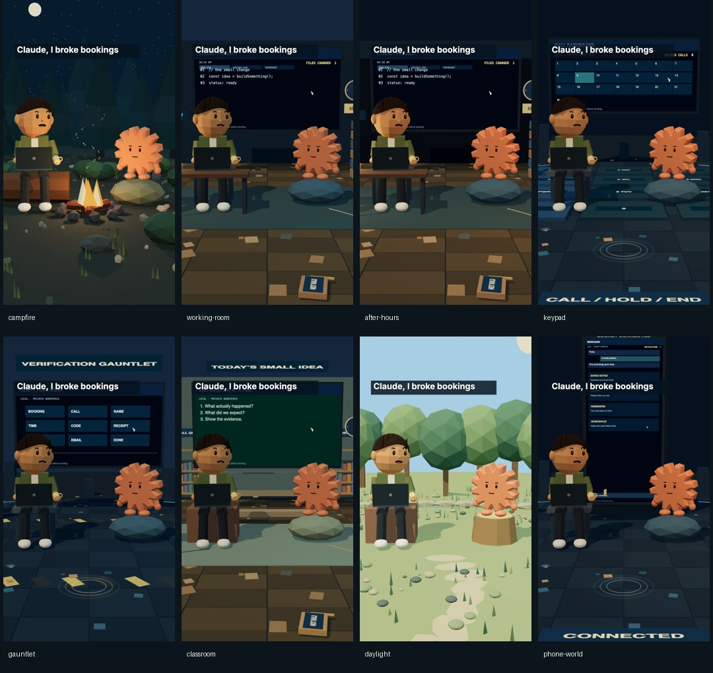
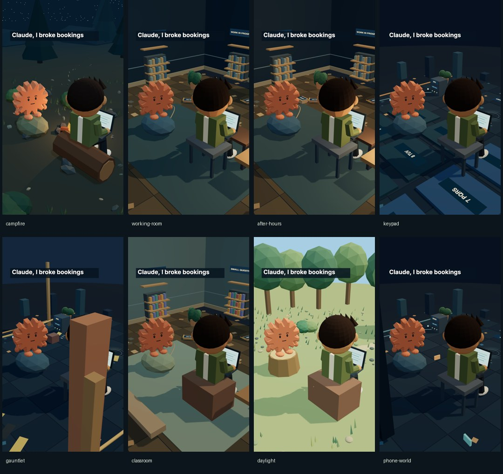

# Campfire Studio

A browser-based animation studio **and an installable agent skill** for repeatable vertical dialogue reels. Reuse the same controllable 3D cast, then change the story, performances, voices, cameras and setting. No video-generation model is needed.


## Run the studio

Requires Node.js 22+ and npm. Python 3 is used by optional agent helpers; FFmpeg/ffprobe are needed for audio assembly and offline video export.

```sh
git clone https://github.com/ar162387/campfire-studio.git
cd campfire-studio
npm ci
npm run build
npm start
```

Open the printed localhost URL (default `http://127.0.0.1:8769`). Use `PORT=8772 npm start` if another studio is already running. Chrome or Edge is recommended for recording.

The starter deliberately has **no spoken audio**. Rehearse in Character Lab, edit the script, then import matching voices. Background audio works locally. Speech generation needs your own connected provider/account.

## Install the skill

After cloning:

```sh
python3 tools/install-skill.py --agent codex
# or:
python3 tools/install-skill.py --agent claude
python3 tools/install-skill.py --agent generic
```

The installer copies `skills/campfire-studio` to `~/.codex/skills`, `~/.claude/skills` or `~/.agents/skills`. Use `--destination /your/skills/folder` for another agent. It refuses to overwrite an existing skill unless explicitly passed `--force`. Restart/reload your agent if needed.

For agents without skill discovery, point them directly to [SKILL.md](skills/campfire-studio/SKILL.md) and [AGENTS.md](AGENTS.md). All instructions are ordinary Markdown. The installer remembers this checkout locally, so the installed skill reuses it automatically. Its `scripts/ensure-studio.py` clones a fresh copy only if no valid checkout is known. `CAMPFIRE_STUDIO_HOME` overrides the remembered location.

Example prompt:

> Use $campfire-studio to make a dialogue reel with two expressive characters in a café. Reuse this engine. Create the café as a scene template, direct the existing rigs and cameras, generate matching voices with my available speech provider, align captions, and export the episode and video.

## Included

- Procedural human and mascot rigs, seven base moods, thirteen actions, custom expressions and live recoloring.
- Eight selectable stages: campfire, working-screen room, after-hours office, giant keypad, verification gauntlet, classroom, daylight park and phone world.
- Six default camera views plus orbit/zoom/pan and named saved cameras.
- Timeline scrubbing, clip selection, dragging, trimming and ripple editing linked to script cards.
- Clause captions with speaker colours by default, optional word highlighting, dialogue-driven mouth movement, atmosphere/music/action layers and ducking.
- Independent body states, persistent blocking/props, screen type-on/interruption events, restrained camera pushes and final pose holds.
- Story checks, a continuity ledger, nine writing prompts, honest research/experiment records and local publishing packs.
- Local autosave, portable JSON with imported audio, browser recording targeting 1080×1920 at 30 fps.
- Agent guides for extending characters, registering backgrounds, generating speech and assembling whole speaker turns without repeated words at cuts.

New settings and character shapes are **code extensions using the same renderer**. The editor exposes templates and selected-line direction. Timing edits move animation/captions, not the speech waveform. Interactive recording smoothness and MP4/WebM support depend on your browser/device; the offline exporter renders each frame independently.

## Reliable video export for agents (including remote/headless workers)

```sh
npm run doctor -- examples/starter.episode.json
npm run render -- episode.json --preview --output output/preview.mp4
npm run render -- episode.json --output output/final.mp4
```

The exporter renders every frame locally using the existing scene engine. It produces native **1080×1920 at 30 fps**, mixes audio offline, verifies the MP4 and resumes completed frames after interruption. The user does not need to open the worker's localhost address. FFmpeg/ffprobe and the pinned Chrome browser are required; npm installs the browser unless downloads were explicitly skipped.

CPU-only worker: add `--software` to doctor and render. It preserves output quality, with speed determined by the measured benchmark. Preview renders a short excerpt at native quality. A silent full performance check is included:

```sh
npm run render -- examples/performance-test.episode.json --silent --talk-preview
```



See the [rendering guide](skills/campfire-studio/references/rendering.md) for setup, diagnostics, audio, resumability, storage and Linux prerequisites.



## Research-informed production (v2)

Muse’s supplied study examined six creators and twenty reels. The user confirms seven agents watched and listened before reviewing captions/metadata. The distilled findings guide the defaults; [evidence provenance](research/evidence.json) keeps creator reports separate from measurements. No reach guarantee is made.

```sh
npm run episode:check -- examples/one-tiny-change.episode.json
npm run render -- examples/one-tiny-change.episode.json --silent --talk-preview --output output/pilot.mp4
npm run pack -- examples/one-tiny-change.episode.json --out output/pilot-pack --video output/pilot.mp4 --silent
```

The original 24-line pilot is fictional and ships silent with estimated timing. Existing saved projects are preserved. The [production guide](skills/campfire-studio/references/story-system.md) covers original scripts, continuity, covers, caption experiments and publishing review. `npm run gallery` renders every set and the state sample for inspection; add `-- --cameras` to inspect all default views. See [implementation and verification](docs/v2-validation.md).



## Detailed settings (v2.1)

The seven newer sets now have coherent foreground, side and reverse-angle dressing, with quiet environmental motion. Office/classroom rooms have floors, rugs, shelves, plants, cables and clocks; the tech stages have circuit tiles, signal motion and surrounding props; the park has a full clearing, path, river ripples, pollen and butterflies. Camera-aware walls and tree visibility keep faces readable. Campfire retains its established design.

## Voice workflow

```sh
python3 tools/voice-directions.py examples/starter.episode.json --out output/voices
# Generate the two takes with your provider and obtain measured word timestamps.
python3 tools/assemble-episode.py episode.json voices/manifest.json --out output/final
```

The official SDK runs only in the local CLI, never in the browser bundle. Connect with `npx -y @elevenlabs/cli@latest onboard init`; follow browser authorization. The credential stays in ignored `.env.local`.

```sh
npm run voice:dialogue -- discover episode.json --out output/cast
# Only for an explicitly authorized, credit-consuming production take:
npm run voice:dialogue -- generate episode.json --out output/take --model eleven_v4 --spend-credits --max-characters 1600
# Local reuse, no provider request:
npm run voice:dialogue -- assemble episode.json --out output/take --model eleven_v4
```

The live helper defaults to a 500-character generation cap and never retries charged speech automatically. Increase the cap deliberately for an approved real episode. Routine tests, scene renders and assembly use no provider credits. `--align-fallback` opts into aligning a saved take; it requires explicit credit authorization too.

For offline ordered scene-request preparation:

```sh
python3 tools/voice-scene.py prepare episode.json --model eleven_v4 --out output/request
```

Preparation is offline. Live generation/alignment requires the caller’s `ELEVENLABS_API_KEY` and an explicit `--spend-credits` flag. The chat plugin does not transfer its credentials. Saved takes are reused; timestamps must pass exact transcript and monotonic checks. Live v4 dialogue has now been tested through the official SDK: a short sample plus a 100.8-second, sixteen-turn scene with validated timing. Existing saved audio is reused during visual testing. See the [full workflow](skills/campfire-studio/references/voices.md).

Import the resulting `output/final/episode.json`. See [voice guidance](skills/campfire-studio/references/voices.md) for manifest format, pronunciation aliases and caption alignment. Neither script spends provider credits.

## Development

```sh
npm run typecheck
npm test
npm run build
```

Source map and extension rules are in [AGENTS.md](AGENTS.md), [character guidance](skills/campfire-studio/references/characters.md), [scene guidance](skills/campfire-studio/references/scenes.md) and the [editor guide](docs/editor.md).

## License and media

Source and included original stage audio are released under MIT; see [LICENSE](LICENSE) and [MEDIA.md](MEDIA.md). This is an independent project, not an official Anthropic, ElevenLabs or Pocketworld product. Provider services, trademarks and third-party dependencies retain their own terms. No private chats, credentials, Instagram footage, cloned voices or reference-reel audio are included.
