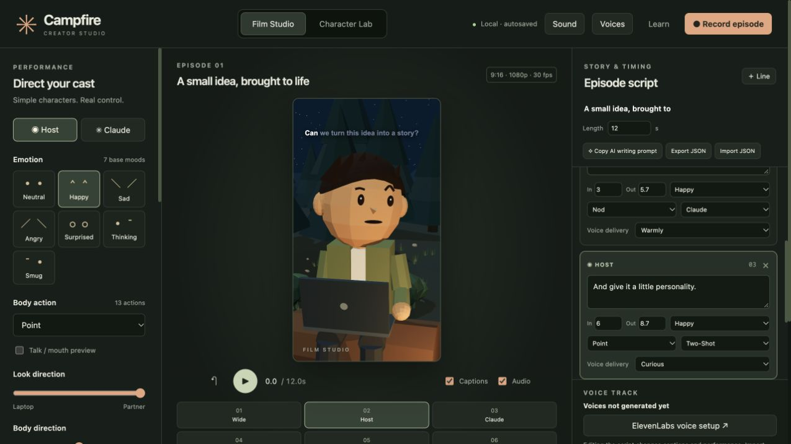

# Campfire Studio

A browser-based animation studio **and an installable agent skill** for repeatable vertical dialogue reels. Reuse the same controllable 3D cast, then change the story, performances, voices, cameras and setting. No video-generation model is needed.



## Run the studio

Requires Node.js 22+ and npm. Python 3 is used by optional agent helpers; FFmpeg is needed for assembling speech.

```sh
git clone https://github.com/ar162387/campfire-studio.git
cd campfire-studio
npm ci
npm run build
npm start
```

Open the printed localhost URL (default `http://127.0.0.1:8769`). Use `PORT=8772 npm start` if another studio is already running. Chrome or Edge is recommended for recording.

The starter deliberately has **no spoken audio**. Rehearse in Character Lab, edit the script, then import matching voices. Background audio works locally. Speech generation needs your own connected provider/account.

## Install the skill

After cloning:

```sh
python3 tools/install-skill.py --agent codex
# or:
python3 tools/install-skill.py --agent claude
python3 tools/install-skill.py --agent generic
```

The installer copies `skills/campfire-studio` to `~/.codex/skills`, `~/.claude/skills` or `~/.agents/skills`. Use `--destination /your/skills/folder` for another agent. It refuses to overwrite an existing skill unless explicitly passed `--force`. Restart/reload your agent if needed.

For agents without skill discovery, point them directly to [SKILL.md](skills/campfire-studio/SKILL.md) and [AGENTS.md](AGENTS.md). All instructions are ordinary Markdown. The installed skill can locate or clone this studio via its `scripts/ensure-studio.py`; set `CAMPFIRE_STUDIO_HOME` to reuse an existing checkout.

Example prompt:

> Use $campfire-studio to make a dialogue reel with two expressive characters in a café. Reuse this engine. Create the café as a scene template, direct the existing rigs and cameras, generate matching voices with my available speech provider, align captions, and export the episode and video.

## Included

- Procedural human and mascot rigs, seven base moods, thirteen actions, custom expressions and live recoloring.
- Campfire stage with stars, bushes, pebbles, firelight and moving embers.
- Six default camera views plus orbit/zoom/pan and named saved cameras.
- Timeline scrubbing, clip selection, dragging, trimming and ripple editing linked to script cards.
- Word-highlight captions, dialogue-driven mouth movement, atmosphere/music/action sound layers and adjustable ducking.
- Local autosave, portable JSON with imported audio, browser recording targeting 1080×1920 at 30 fps.
- Agent guides for extending characters, registering backgrounds, generating speech and assembling whole speaker turns without repeated words at cuts.

New settings and character shapes are **code extensions using the same renderer**. The shipped scene is campfire; the editor does not currently have a template-picker UI. Timing edits move animation/captions, not the speech waveform. Recording smoothness and MP4/WebM support depend on your browser/device.

## Voice workflow

```sh
python3 tools/voice-directions.py examples/starter.episode.json --out output/voices
# Generate the two takes with your provider and obtain measured word timestamps.
python3 tools/assemble-episode.py episode.json voices/manifest.json --out output/final
```

Import the resulting `output/final/episode.json`. See [voice guidance](skills/campfire-studio/references/voices.md) for manifest format, pronunciation aliases and caption alignment. Neither script spends provider credits.

## Development

```sh
npm run typecheck
npm test
npm run build
```

Source map and extension rules are in [AGENTS.md](AGENTS.md), [character guidance](skills/campfire-studio/references/characters.md), [scene guidance](skills/campfire-studio/references/scenes.md) and the [editor guide](docs/editor.md).

## License and media

Source and included original stage audio are released under MIT; see [LICENSE](LICENSE) and [MEDIA.md](MEDIA.md). This is an independent project, not an official Anthropic, ElevenLabs or Pocketworld product. Provider services, trademarks and third-party dependencies retain their own terms. No private chats, credentials, Instagram footage, cloned voices or reference-reel audio are included.
